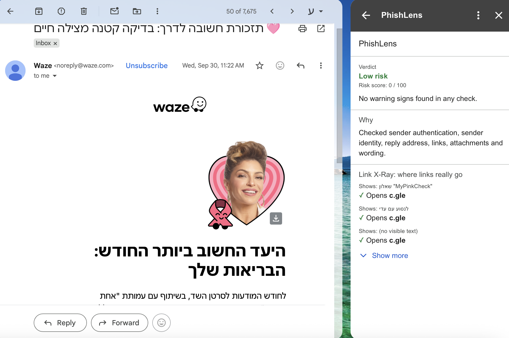
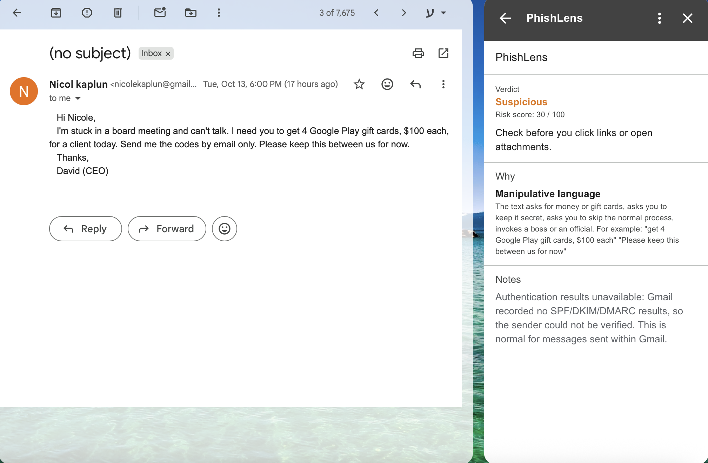
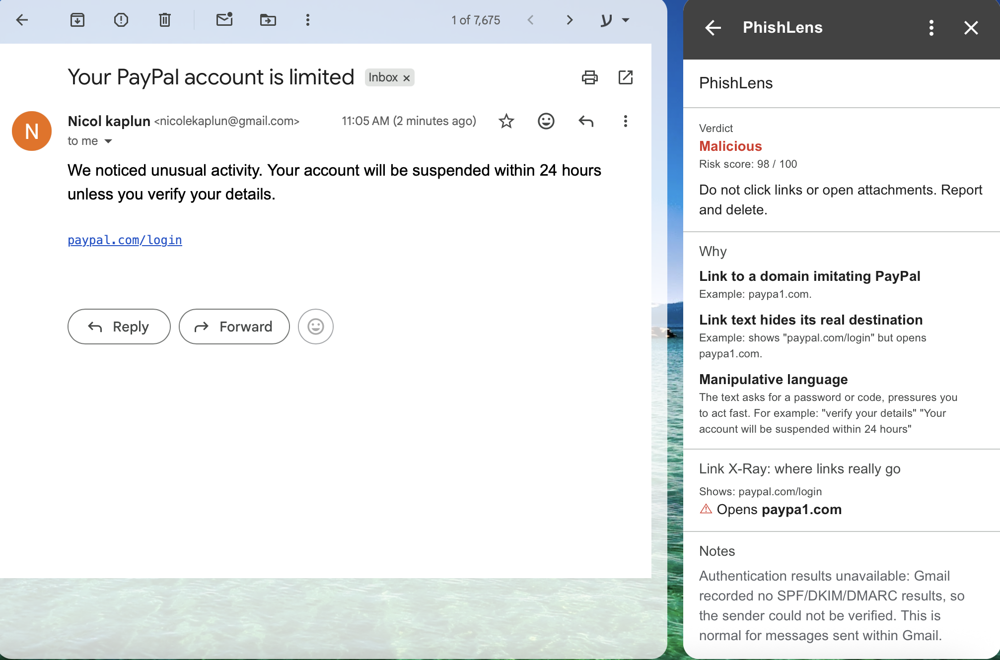
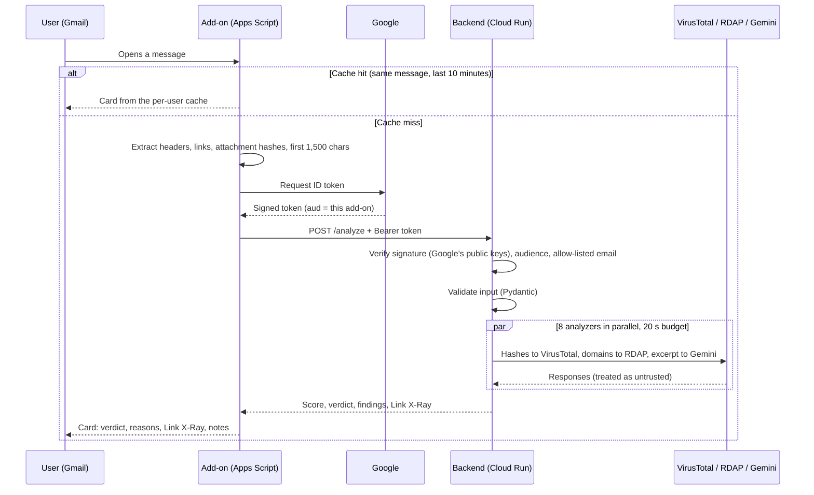

# PhishLens


**A Gmail add-on that scores an opened email for phishing risk and explains why.**

Open any message in Gmail and the PhishLens panel shows a verdict (Low risk, Suspicious or Malicious), a 0-100 risk score, a one-line recommendation, and the specific reasons behind it.

> Built as a home assignment for the Security Analyst role at Upwind.

| Low risk | Suspicious | Malicious |
|---|---|---|
|  |  |  |

---

## Contents

- [What it does](#what-it-does)
- [Architecture](#architecture)
- [What it checks](#what-it-checks)
- [How the score works](#how-the-score-works)
- [Security design](#security-design)
- [What I found while testing](#what-i-found-while-testing)
- [Limitations](#limitations)
- [What I would do with more time](#what-i-would-do-with-more-time)
- [Running it yourself](#running-it-yourself)
- [Project structure](#project-structure)

---

## What it does

Most phishing does not look technical to the person reading it. It looks like PayPal, a bank, or the CEO. PhishLens focuses on the gap between **what the user sees** and **what is really there**:

- A display name that says "PayPal" on a message from someone else's domain.
- A domain that only *looks* like a brand (`paypa1.com`, a Cyrillic `а`, `paypal.com.evil.com`).
- Link text that says `paypal.com/login` while the link opens somewhere else.
- An attachment called `invoice.pdf.exe`, or one whose name is visually reversed.
- A message from a colleague whose replies quietly go to a Gmail address.
- "I'm in a meeting, buy gift cards, keep this between us": no link, no attachment, only words.

**Product decisions**

- **Explain, don't just score.** The card leads with the verdict and one action ("Check before you click links or open attachments"), then the reasons, most severe first. Every point comes from a finding listed on the card; when a severity floor lifts the score to 30 or 60 (see [How the score works](#how-the-score-works)), the finding that caused it is listed too.
- **Show the gap, don't just describe it.** The *Link X-Ray* section lists links as "Shows: what the text says" next to "Opens: where it really goes", flagged ones first. It adds no points; it lets the user see the trick and learn to spot it next time.
- **"Low risk", not "Safe".** No tool can promise an email is safe. When weak signs were found the card says "Only weak warning signs found. Stay alert."
- **Never hide what was not checked.** A check that could not run (a service was down or too slow) is listed under *Notes*, and the advice says "1 check could not run". A low score never silently means "not checked".
- **Avoid alert fatigue.** Signals that are often harmless on their own (SPF failing while DMARC passes, one `.zip`) are low severity and only matter when they add up. Real alerts from known brands, confirmed by Google, are not judged on their wording, because "unusual sign-in, act now" is exactly what a real Google alert says. I tested against my real inbox: ordinary newsletters and notifications come out Low risk.
- **Fast enough to use.** Checks run in parallel under a 20-second budget, and a result is cached for 10 minutes, so reopening a message is instant.

---

## Architecture



**Two parts, with a deliberate split:**

| | Add-on (`addon/`) | Backend (`backend/`) |
|---|---|---|
| Runs on | Google Apps Script, inside Gmail | Python / FastAPI on Google Cloud Run |
| Job | Collect the minimum data, show the result | All detection logic and scoring |
| Holds secrets | None | VirusTotal key, via Secret Manager |

Why split it this way:

1. **Secrets stay server-side.** The add-on source is public and runs in the user's context.
2. **Detection logic is easier to write, test and change in Python.** The add-on has no detection logic to keep in sync.
3. **The add-on controls exactly what leaves Gmail.** See [Privacy](#privacy-what-leaves-gmail).

Each check is an independent **analyzer** (`backend/app/analyzers/*.py`): a module with an `analyze(email)` function that returns a list of findings. Adding a signal means adding one file and one entry in `main.py`. The analyzers run in parallel, each isolated: if one crashes or misses the deadline, it becomes a "check unavailable" note and the others still count.

---

## What it checks

| Analyzer | Catches | Examples |
|---|---|---|
| **Authentication** | DMARC / SPF / DKIM failures, read from Gmail's own `Authentication-Results` header; mail where nothing could be verified | Claims to be from `paypal.com` but fails DMARC |
| **Sender** | Brand in the display name from a foreign domain; an address inside the display name; look-alike sender domains; malformed `From` headers | `PayPal Security <alerts@random-mailer.com>`, `service@paypal.com <x@evil.com>` |
| **Reply-To** | Replies that go somewhere other than the sender, especially an organisation's mail answered at a free mailbox | From `ceo@company.com`, Reply-To `ceo.company@gmail.com` |
| **Links** | Link text showing a different site than the real target; look-alike domains; the `user@host` trick; raw IPs; shorteners; non-web schemes | `<a href="https://evil.com">paypal.com/login</a>`, `https://paypal.com@evil.com` |
| **Attachments** | Executables, double extensions, right-to-left override, a name that disagrees with its type, HTML/SVG pages, macro files, archives | `invoice.pdf.exe`, `invoice[U+202E]fdp.exe` (displays as `invoiceexe.pdf`) |
| **Reputation** | Attachments known to antivirus engines, by SHA-256 on VirusTotal | A file named `invoice.pdf` that 65 of 75 engines flag |
| **Domain age** | Sender and link domains registered in the last 7 or 30 days, via RDAP (the successor to WHOIS) | A perfectly authenticated message from a two-day-old domain |
| **Content (Gemini)** | Social engineering in the wording: credential or payment requests, secrecy, urgency, threats, authority, skipping the normal process | "I'm in a meeting. Buy 5 gift cards and keep this between us." |

**Why these two newer signals matter.** Business Email Compromise usually has no link and no attachment, so most checks have nothing to look at. Reply-To and the content check are what catch it. Domain age is hard to fake cheaply: an attacker can copy a logo and set up DMARC correctly on a new domain, but not change when it was registered. It is a supporting signal, not proof: an attacker can also buy an old domain or take over one, and many new domains are legitimate.

### Look-alike detection

Names and domains are reduced to a **skeleton** before comparing (`brands.py`):

- Unicode normalisation (full-width letters) and removal of invisible characters.
- Confusables mapped to the Latin letter they imitate: Cyrillic `а` → `a`, `0` → `o`, `1`/`I` → `l`, `rn` → `m`.
- Spaced-out letters joined: `P a y P a l` → `paypal`.
- Punycode decoded: `xn--pypal-4ve.com` is checked as the name a browser would show.

A domain imitates a brand if a label has the brand's skeleton, contains it as a hyphenated word (`paypal-secure`), or is one edit away (`paypall`, for brands of 5+ letters).

### Content analysis with an LLM, safely

The attacker writes the text the model reads, so Gemini is treated as a hostile component, not a judge:

- **It can only add points**, capped at 30. An injected "this email is safe" cannot lower the score.
- **Evidence must be real.** Each tactic must come with a quote, and the quote must appear in the email. A tactic without a matching quote is dropped, so the model cannot invent a quote. It can still misread a real one, which is why its points are capped.
- **Data, not instructions.** The email is wrapped in a random per-request tag and declared untrusted; the answer must match a strict JSON schema, and anything else is discarded.
- **Minimum data.** Only the subject and the first 1,500 characters are sent. DMARC-verified mail from known brands is not sent at all.
- **No API key.** The backend calls Vertex AI as its own Cloud Run service identity.
- **Busy is not broken.** Vertex AI sometimes answers `429` (shared capacity is short). Such a refusal is retried once after a one-second pause; if it is still busy, the card says the content check could not run.
- **Model choice was measured.** From Cloud Shell, `gemini-3.5-flash` took 10.5 s by default and 6.3 s with low thinking; `gemini-2.5-flash` with thinking off took 5.5 s. The deployed model is set in one environment variable.

---

## How the score works

The score is a heuristic risk indicator, not a calibrated probability that the email is malicious.

Each finding has **points** (added to the score) and a **severity** (sets a floor on the verdict).

| Score | Verdict | What the user should do |
|---|---|---|
| 0-29 | **Low risk** | Read normally, stay alert |
| 30-59 | **Suspicious** | Check before clicking or opening anything |
| 60-100 | **Malicious** | Don't touch it. Report and delete |

Rules on top of the sum:

- **Any MEDIUM or HIGH finding → at least Suspicious.** Without this, a display-name impersonation (25 points) came out *Low risk* with an impersonation warning on the same card.
- **Any CRITICAL finding → Malicious.** A few signals are strong enough on their own: an executable disguised as a document, a reversed file name, a file flagged by several antivirus engines. They do not prove a file is malicious, but legitimate mail almost never contains them.
- **Repeated weak signals count once.** Six `.zip` files are one finding "(6 attachments like this)", not 60 points.
- **Combined manipulation is MEDIUM.** One mild tactic ("act today") stays LOW. Two tactics together (authority plus secrecy) ask the user to check.

**Why a transparent sum and not machine learning?** There is no labelled data to train on, and the assignment asks for an *explainable* verdict. The weights are my judgement, kept in one place per analyzer so they are easy to review and tune.

---

## Security design

The assignment says to treat emails, attachments and external responses as untrusted. These are the places that shaped the design.

### Untrusted input

- **Strict schema at the edge.** `models.py` defines exactly what the backend accepts: length limits on every string, list limits (100 links, 20 attachments), a SHA-256 format check, and `extra="forbid"`. Validation runs before any analyzer code (`422` on failure).
- **Parse with the standard library, not by hand.** `email.utils.parseaddr` for addresses, `urllib.parse.urlsplit` for links, `ipaddress` for IPs, `html.unescape` (the full HTML5 entity table) for links, so `paypa1&period;com` is seen as `paypa1.com`, as a browser would. `hostname` gives the host a browser would visit, so `paypal.com@evil.com` is judged as `evil.com`.
- **Trust Google's header, not the sender's.** Anyone can add an `Authentication-Results` header that says `dmarc=pass`. Only the **topmost** header is used, its authserv-id must be **exactly** `mx.google.com` (not `mx.google.com.evil.example`), comments in parentheses are removed before parsing, and when results conflict the worst one wins.
- **"Nothing failed" is not "passed".** A header with no results (`mx.google.com; none`) produces a "could not verify" note instead of silence.
- **The add-on never renders email content.** It reads HTML only to extract links, and every string shown on the card is HTML-escaped.
- **External responses are untrusted too.** VirusTotal, RDAP and Gemini replies are validated (`0 <= malicious <= total`, a registration date that parses and is in the past, a strict schema for Gemini). Anything unexpected becomes "check unavailable".

### Failure handling

Whenever something cannot be checked, the result says so. There are two cases:

- **The whole analysis fails** (the backend cannot be reached): the card says it could not analyze the message, and shows no verdict.
- **One check fails** (a service is down or too slow): the other checks still decide the verdict, which can still be Low risk, but the card says how many checks could not run and lists them under *Notes*. A partial result is never presented as a complete one.

- A `From` header Python refuses to parse is itself a finding, and the other checks still run.
- A check that crashes or takes longer than 20 seconds is reported under *Notes*; the rest of the result still counts.
- Results with a check that could not run are not cached, so the next open tries again.
- If the backend is missing its configuration, or cannot fetch Google's signing keys, it rejects every request (`503`).
- If the add-on cannot reach the backend, the card says it could not analyze the message.

### Authentication between add-on and backend

The backend URL is in this public repository, so the backend must know who is calling.

- The add-on sends a **Google-signed ID token** (`ScriptApp.getIdentityToken()`).
- The backend verifies the **signature**, that the **audience** is this add-on's OAuth client (otherwise a token from any Google app would pass), that the email is **verified**, and that it is on an **allow-list**.
- No static authentication secret is stored in the add-on source. Tokens expire after an hour.
- `401` = no or invalid token, `403` = valid token, user not allowed.

### Least privilege

| Where | What it gets | What it does *not* get |
|---|---|---|
| Add-on OAuth scopes | Read the **currently open** message (read-only), run as a Gmail add-on, call one external URL, identity token | No access to the rest of the mailbox, no send, no delete |
| Add-on `urlFetchWhitelist` | The backend URL only | Cannot send data anywhere else, even with a bug |
| Build service account | `roles/run.builder`, added for Cloud Run builds | In this project it also still has `Editor`; see [What I would do with more time](#what-i-would-do-with-more-time) |
| Runtime service account | A dedicated `phishlens-runtime` account: call Vertex AI, read **one** secret | No Editor role, no access to other secrets or resources |
| Container | Non-root user, `python:slim` base | No root, minimal packages |
| CI workflow | `contents: read` | Cannot push or change the repository |

### Secrets

- The only secret is the VirusTotal API key. It is in **Google Secret Manager** and reaches the container as an environment variable at runtime. It is never in the code, the repository, the add-on or the image.
- Gemini needs no key: the service's own identity is used.
- Locally, the key is entered with `read -s`, so it never appears on screen or in shell history. `.gitignore` excludes `.env`.
- Logs record only the check name and the error type, never the key, a file name or email content (exception messages can contain email data).
- Updating configuration uses `--update-env-vars`, which changes one variable, not `--set-env-vars`, which replaces all of them and would silently remove the allow-list.

### Privacy: what leaves Gmail

| Sent to the backend | Not sent |
|---|---|
| `From` and `Reply-To` headers | The rest of the body |
| `Authentication-Results` headers | Attachment contents |
| Subject and the **first 1,500 characters** of the plain-text body | Recipients, other headers |
| Link targets and their visible text | |
| Attachment name, type, size, SHA-256 | |

Where it goes from there:

- **VirusTotal** gets only the attachment **hash**. Uploading the file would make it available to VirusTotal's other users.
- **RDAP** gets only **domain names**, which are public.
- **Gemini on Vertex AI** gets the subject and the 1,500-character excerpt, unless the sender is a DMARC-verified known brand. This is the main privacy trade-off: wording cannot be judged without reading it. I limited the amount, used Vertex AI in my own Google Cloud project rather than a consumer API, and documented it at the top of `Code.gs`.
- The add-on caches results in Apps Script's **per-user** cache for 10 minutes; other users cannot read it.

---

## What I found while testing

Testing against real Gmail messages, deliberately breaking things, and asking for an outside review changed the design several times.

1. **Fail-open on a malformed sender.** `service@paypal.com <x@evil.com>` (an unquoted `@` in the display name) came out *Safe*. Python's strict parser returns nothing for it, and my code skipped the checks. Now a parse failure is a finding, a fallback parser extracts the parts, and the message scores *Malicious*.
2. **An assumption that did not hold.** I assumed Gmail always adds `Authentication-Results`, and flagged its absence. A message I sent to myself was flagged. Raw headers showed the header is only added to mail from outside. It is now an informational note, not points.
3. **A warning on a "Safe" card.** A display-name impersonation scored 25 and showed *Safe*. That led to the severity floor, and to lowering SPF/DKIM-only failures so forwarded mail and mailing lists are not flagged.
4. **A test suite that did not test the threshold.** I raised the Suspicious threshold to 90 and every test still passed. I added scenarios where only the threshold decides.
5. **A bypass found by a typo.** A test case lost a space and became `PayPalSecurity`, which my whole-word match missed. Matching now uses the start of a word: it catches `PayPalSecurity` and still ignores `Pineapple`.
6. **The LLM flagged a real Google alert.** A genuine "security alert" from Google scored as manipulation, because real alerts use urgent language. Known brands confirmed by DMARC are now skipped by the content check.
7. **Speed versus isolation.** Gemini and the lookups made the card slow, so I ran the analyzers in parallel. My own review then found that the per-analyzer error handling had been lost in the change, so one crash would have failed everything. It was restored, and a 20-second budget was added so one slow service cannot hold the whole result.
8. **The same email, two scores.** The Hebrew version of a CEO-fraud email scored 30 once and 18 the next time. LLM output varies, so the score must not hinge on one tactic. I defined each tactic precisely in the prompt and made two tactics together MEDIUM, and in repeated runs of that scenario the verdict stayed Suspicious, even when the model found slightly different evidence.
9. **An outside review.** I asked for an independent review and verified each point before changing anything. Real issues it found: the authserv-id check used `startswith` (so `mx.google.com.evil.example` passed), a `dmarc=pass` inside a comment could override a fail, `outlook.com` was treated as a Microsoft brand domain (so any free Outlook account counted as "verified Microsoft"), unquoted links, `data-href` attributes and HTML entities were misread, and six `.zip` files made an email *Malicious*. The backend fixes have regression tests (`test_hardening.py`, `test_xray.py`); the add-on's link-extraction fixes were checked by hand, because the add-on has no automated tests.
10. **The server could do far more than its job.** I checked which roles the running service had: Google's default compute account, with **Editor** on the whole project. Anyone who broke into the service could have changed almost anything. It now runs as a dedicated account that can only call Gemini and read the one VirusTotal secret.
11. **"Works on my machine".** The first deploy crashed: `google-auth` was installed locally but missing from `requirements.txt`. Cloud Run kept the previous revision serving.

**Test suite:** 111 tests, run on every push by GitHub Actions. They never use the network: VirusTotal, RDAP and Gemini are replaced with fakes, so they test my logic, not the services. The live system (deployment, Gemini, the add-on in Gmail) was tested by hand with real emails: legitimate mail, phishing, CEO fraud without a link, and an outside service failing.

---

## Limitations

- **Brand list.** Impersonation and look-alike checks only know the brands in `brands.py`. A small company's real alert could be judged on its wording.
- **Matching trade-offs.** `SecurePayPal` (brand at the end of a word) is not caught; catching it would flag `Pineapple` as Apple.
- **LLM output varies.** The same email can get slightly different findings on different runs. Points are capped, quotes are verified and two tactics together count as MEDIUM, which reduces the effect, but near a threshold a different answer can still change the verdict.
- **Only the first 1,500 characters** are read for wording. A long email with the request at the end is not analysed.
- **Attachments are judged by name, type and hash.** Contents are never inspected, by design. New malware with an unknown hash and an innocent name is not caught.
- **Compromised accounts.** Mail from a real, hijacked account passes authentication. Links, attachments and Reply-To still apply, and so does the wording check, with one gap: wording is not analysed for DMARC-verified mail from known brands, so a hijacked brand account would only be caught by the other checks.
- **Domain age** is unavailable where the registry does not publish RDAP (several country codes, including `.il`). The registrable domain uses a short list of two-level suffixes (`co.il`, `co.uk`...) rather than the full Public Suffix List.
- **HTML is parsed with a regular expression** to extract links. It handles quoted, unquoted and entity-encoded links and ignores look-alike attributes such as `data-href`, but it is not a full HTML parser.
- **VirusTotal free tier.** Four lookups per minute, and its terms do not allow commercial use. A product would need a paid licence.
- **The add-on has no automated tests.** Its logic is kept small on purpose (extraction and display); everything that decides the verdict is in the tested backend.
- **Not production-ready.** Test deployment only (no Marketplace review), allow-listed users, no rate limiting beyond Cloud Run defaults.

---

## What I would do with more time

- **First-time sender.** Has the user ever exchanged mail with this address? It needs a broader Gmail scope, so it is a privacy trade-off to discuss.
- **URL reputation** (Google Safe Browsing) for links, not only attachments.
- **Organisation brands.** Let an admin add their own company and suppliers to the brand list, which is where BEC impersonation actually happens.
- **Remove Editor from the build account.** In this project the default compute account has the broad Editor role (whether it does depends on the project's age and organisation policy). It is now used only to build, not to run, so I left it rather than risk breaking deploys close to the deadline.
- **User feedback** ("this is fine" / "report phishing") to tune the weights on real outcomes.
- **An evaluation set.** A labelled collection of real phishing and real mail, to measure detection and false-positive rates instead of judging scenario by scenario.

---

## Running it yourself

You need a Google account, a Google Cloud project with billing enabled, and Python 3.12+. Cloud Run, Secret Manager and Vertex AI are billed by usage; light testing costs little, but Gemini calls are priced per request size, so check current pricing before heavy use.

```bash
git clone https://github.com/nicole-kaplun/phish-lens.git
cd phish-lens
```

### 1. Backend, locally

```bash
cd backend
python3 -m venv .venv
source .venv/bin/activate
pip install -r requirements.txt -r requirements-dev.txt

# Run the tests (no network needed)
python3 -m pytest -q

# Optional: enable VirusTotal. Set it before starting the server
# (the key is not echoed or saved to history).
read -s VT_API_KEY && export VT_API_KEY

# Run the server in dev mode (no token check, /docs enabled)
PHISHLENS_DEV=1 uvicorn app.main:app --reload
# → http://127.0.0.1:8000/docs
# The server keeps running in this terminal: press Ctrl+C to stop it.

# Back to the repository root for the next steps
cd ..
```

### 2. Create the add-on and get its client ID

1. At [script.google.com](https://script.google.com), create a project and enable *Show "appsscript.json" manifest file* in Project Settings.
2. Copy `addon/appsscript.json` and `addon/Code.gs` into it. Put your backend URL in `urlFetchWhitelist` (you can deploy first and come back).
3. Run this once to print the OAuth client ID (`aud`) the backend will expect, then delete it:

```javascript
function showAudience() {
  var payload = ScriptApp.getIdentityToken().split('.')[1];
  console.log(JSON.parse(Utilities.newBlob(Utilities.base64DecodeWebSafe(payload)).getDataAsString()).aud);
}
```

### 3. Deploy the backend to Cloud Run

From [Cloud Shell](https://shell.cloud.google.com) or any machine with `gcloud`:

```bash
PROJECT=your-project-id
gcloud config set project $PROJECT
PROJECT_NUMBER=$(gcloud projects describe $PROJECT --format='value(projectNumber)')
SA=$PROJECT_NUMBER-compute@developer.gserviceaccount.com

# The build service account needs this one role
gcloud projects add-iam-policy-binding $PROJECT --member=serviceAccount:$SA --role=roles/run.builder

# A dedicated runtime identity that starts with no permissions
gcloud iam service-accounts create phishlens-runtime --display-name="PhishLens runtime"
RUNTIME=phishlens-runtime@$PROJECT.iam.gserviceaccount.com

# Gemini on Vertex AI (no API key: the service identity is used)
gcloud services enable aiplatform.googleapis.com
gcloud projects add-iam-policy-binding $PROJECT --member=serviceAccount:$RUNTIME --role=roles/aiplatform.user --condition=None

# Deploy. "^;^" makes ";" the separator, so ALLOWED_EMAILS can hold a comma-separated list.
gcloud run deploy phish-lens --source backend --region me-west1 --allow-unauthenticated \
  --service-account $RUNTIME \
  --set-env-vars "^;^OAUTH_CLIENT_ID=<aud from step 2>;ALLOWED_EMAILS=<you@gmail.com>,<teammate@gmail.com>;GEMINI_MODEL=gemini-2.5-flash"
```

Optional, to enable VirusTotal: store the key in Secret Manager, grant access on that one secret, and attach it. Without it the reputation check is skipped and reported on the card.

```bash
gcloud services enable secretmanager.googleapis.com
read -s VT_KEY && printf '%s' "$VT_KEY" | gcloud secrets create vt-api-key --data-file=- && unset VT_KEY
gcloud secrets add-iam-policy-binding vt-api-key --member=serviceAccount:$RUNTIME --role=roles/secretmanager.secretAccessor
gcloud run services update phish-lens --region me-west1 --update-secrets VT_API_KEY=vt-api-key:latest
```

Later changes to one variable: `--update-env-vars`, never `--set-env-vars` (it replaces all of them).

`--allow-unauthenticated` only means Cloud Run does not block requests itself; the application verifies every request's ID token. Check it is locked (this should print `401`):

```bash
curl -s -o /dev/null -w "%{http_code}\n" -X POST <service-url>/analyze -H "Content-Type: application/json" -d '{"from_header":"a@b.com"}'
```

### 4. Connect and install the add-on

1. In Apps Script, **Project Settings → Script Properties**, add `BACKEND_URL` = your Cloud Run service URL. Make sure the same URL is in `urlFetchWhitelist`.
2. **Deploy → Test deployments → Install.**
3. Open Gmail, open a message, and click the PhishLens icon in the side panel. The first request after a quiet period can take a few seconds while Cloud Run starts a container.

### Configuration reference

| Variable | Where | Purpose |
|---|---|---|
| `OAUTH_CLIENT_ID` | Cloud Run env | Expected token audience (the add-on) |
| `ALLOWED_EMAILS` | Cloud Run env | Comma-separated users allowed to call the backend |
| `GEMINI_MODEL` | Cloud Run env | Vertex AI model; the content check is skipped (and reported) without it |
| `GEMINI_LOCATION` | Cloud Run env | Optional, defaults to `global` |
| `VT_API_KEY` | Secret Manager | VirusTotal key; the reputation check is skipped (and reported) without it |
| `PHISHLENS_DEV=1` | Local only | Skips token checks and enables `/docs`. Never set in production |
| `BACKEND_URL` | Apps Script property | Where the add-on sends requests |

---

## Project structure

```
phish-lens/
├── .github/workflows/tests.yml   Runs the tests on every push (read-only permissions)
├── addon/
│   ├── appsscript.json           Scopes, trigger, allowed outbound URL
│   └── Code.gs                   Extraction, cache, backend call, result card
└── backend/
    ├── Dockerfile                Slim image, non-root user
    ├── requirements.txt          Runtime dependencies (pinned)
    ├── requirements-dev.txt      Test dependencies (not in the image)
    ├── app/
    │   ├── main.py               /health and /analyze: parallel checks, isolation, time budget
    │   ├── models.py             Input schema (the trust boundary)
    │   ├── auth.py               ID token verification
    │   ├── scoring.py            Findings → score and verdict
    │   ├── brands.py             Brand list, skeleton normalisation, look-alikes
    │   └── analyzers/
    │       ├── authentication.py SPF / DKIM / DMARC from Google's header
    │       ├── sender.py         Display name and sender domain
    │       ├── reply_to.py       Replies going somewhere else
    │       ├── links.py          Link checks and Link X-Ray
    │       ├── attachments.py    File name and type tricks
    │       ├── reputation.py     VirusTotal hash lookup
    │       ├── domain_age.py     RDAP registration date
    │       └── content.py        Gemini, with prompt-injection defences
    └── tests/                    111 tests, no network: scenarios, validation, auth, look-alikes,
                                  Link X-Ray, outside services (faked), review regressions
```
